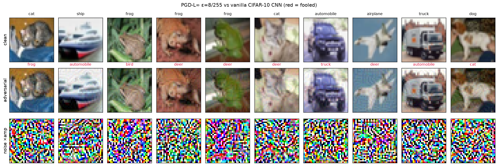
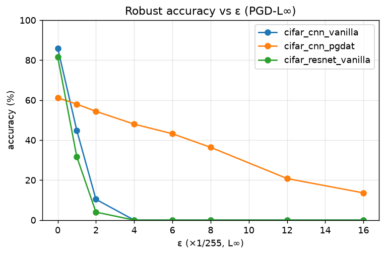
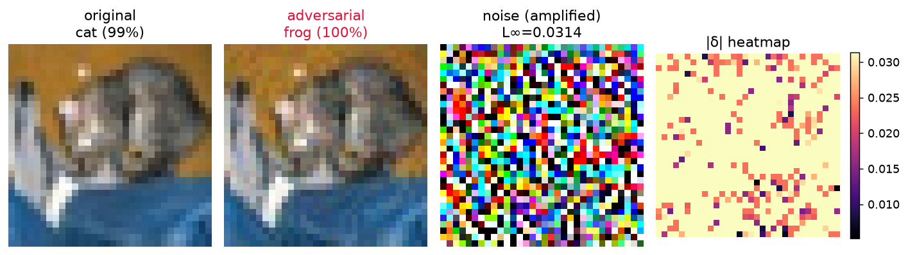
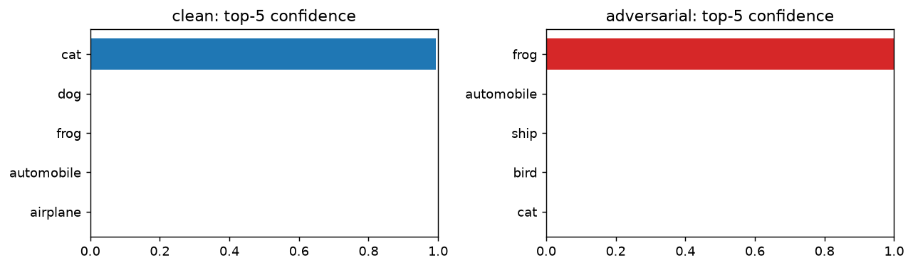

# 🛡️ AdvRobust Studio

[](https://github.com/spoukidev/advrobust-studio/actions/workflows/ci.yml) [](LICENSE)

**An adversarial attack & defense workbench for image classifiers — hand-written FGSM / PGD / C&W in PyTorch, three defenses, PGD adversarial training, black-box transfer, a Streamlit UI, and a one-command robustness benchmark.**



*Top: clean CIFAR-10 test images (all correctly classified). Middle: PGD-L∞ adversarial images at ε = 8/255 — every one is misclassified (red). Bottom: the perturbation, amplified for visibility.*

## Headline results (`make bench`, CPU, 500 CIFAR-10 test images)

| Model | Clean acc | FGSM ε=8/255 | PGD-L∞ ε=8/255 (10 steps) | PGD-L2 ε=0.5 | C&W-L2 ε=0.5* |
|---|---|---|---|---|---|
| `cifar_cnn_vanilla` (standard training) | 86.8% | 2.2% | **0.0%** | 0.4% | 1.5% |
| `cifar_resnet_vanilla` (standard training) | 81.0% | 2.2% | **0.0%** | 0.0% | 1.0% |
| `cifar_cnn_pgdat` (PGD adversarial training) | 60.4% | 39.2% | **37.4%** | 48.2% | 49.0% |

Numbers are **robust accuracy** (higher = more robust). \*C&W evaluated on the first 200 images (clean acc on that subset: 87.5% / 83.0% / 63.5%).

**Adversarial training works — at a price.** Under PGD-L∞ at ε = 8/255 the vanilla CNN drops to **0.0%** while the PGD-AT CNN keeps **37.4%** (**+37.4 pp**). The cost is clean accuracy: 86.8% → 60.4% after only 10 CPU epochs — the classic robustness/accuracy trade-off.



**Preprocessing defenses mostly don't.** Against an adaptive attacker (BPDA / EOT), JPEG, bit-depth squeezing and randomized smoothing leave the vanilla CNN at 0–1% robust accuracy. JPEG looks like it helps (6.5%) only when the attacker ignores it.

**Attacks transfer.** PGD crafted on the vanilla CNN drops the unseen ResNet from 81.0% → 9.6% (88% transfer rate), but barely touches the PGD-AT model (60.4% → 59.8%). On ImageNet, PGD (ε = 4/255) crafted on ResNet-18 flips EfficientNet-B0's prediction on 3 of 5 demo photos.

Full report: [`results/sample/report.md`](results/sample/report.md) (also `report.html`, machine-readable `results.json`).

| | |
|---|---|
|  |  |
| original · adversarial · amplified noise · \|δ\| heatmap | class confidences before vs after the attack |

---

## Features

- **White-box attacks written from scratch** (the math is in the repo, no attack library required):
  - FGSM (Goodfellow et al., 2015)
  - PGD with L∞ and L2 projections, random start, targeted / untargeted (Madry et al., 2018)
  - C&W-L2 (Carlini & Wagner, 2017), simplified fixed-c variant in tanh space
- **Black-box transfer**: craft on a surrogate, evaluate on a victim (CIFAR CNN ↔ ResNet; ImageNet ResNet-18 → EfficientNet-B0).
- **Defenses**
  - Input preprocessing: JPEG re-compression and bit-depth squeezing, with BPDA (straight-through) gradients for adaptive attacks
  - Randomized smoothing (Monte-Carlo vote under Gaussian noise), with EOT for adaptive attacks
  - **PGD adversarial training** (3-step PGD, ε = 8/255) vs a vanilla baseline
- **Metrics**: clean accuracy, robust accuracy, attack success rate, mean/max L∞ and L2 — every perturbation is audited against its budget.
- **Visualizations**: original | adversarial | amplified noise | heatmap, confidence bars, robust-accuracy-vs-ε curves, image grids.
- **Reports**: Markdown, HTML and JSON from one command.
- **Streamlit UI**: pick a model, attack, ε slider, steps, targeted mode, and a defense; upload your own image or browse CIFAR-10.

## Quick start

Requires Python 3.11+. Everything runs on CPU.

```bash
git clone <this repo> advrobust-studio && cd advrobust-studio
python -m venv .venv && source .venv/bin/activate
pip install -r requirements.txt --extra-index-url https://download.pytorch.org/whl/cpu
pip install -e .

make test     # pytest: budgets, defenses, report schema, headless UI
make bench    # full benchmark -> results/report.md (+ .html, .json, figures/)
make ui       # streamlit run app/ui.py  -> http://localhost:8501
```

The three small CIFAR-10 checkpoints (< 1.2 MB each) are committed in [`checkpoints/`](checkpoints/), so `make bench` and `make ui` work immediately. CIFAR-10 (~170 MB) is downloaded and cached in `data/` on first use (torchvision, with a Hugging Face parquet mirror as fallback). The ImageNet transfer demo downloads torchvision's ResNet-18 and EfficientNet-B0 weights; if that fails it is skipped and the rest of the benchmark still runs.

| Command | What it does | Time (8-core CPU) |
|---|---|---|
| `make data` | download + cache CIFAR-10 | ~1 min |
| `make train` | train missing checkpoints (skips existing ones) | ~7 min vanilla CNN, ~5 min ResNet, ~35 min PGD-AT |
| `make bench` | full benchmark → `results/` | ~2 min |
| `make bench-quick` | 64-image smoke run → `results/quick/` | ~20 s |
| `make sample` | copy the latest bench into `results/sample/` | instant |
| `make test` | pytest | ~5 s |
| `make ui` | Streamlit app | — |

To retrain from scratch: `python experiments/train_models.py --force` (or `--only cifar_cnn_pgdat`). All hyper-parameters live in [`config/default.yaml`](config/default.yaml).

## Python API

```python
import torch
from studio.data import load_cifar10, to_float
from studio.models import load_cifar_checkpoint
from studio.attacks import pgd_linf, fgsm, cw_l2
from studio.defenses import wrap_with_defense
from studio.eval import evaluate_attack

x, y = load_cifar10("data", train=False, limit=256)
x = to_float(x)
model = load_cifar_checkpoint("checkpoints/cifar_cnn_vanilla.pt")

x_adv = pgd_linf(model, x, y, eps=8/255, steps=10)
assert (x_adv - x).abs().max() <= 8/255 + 1e-6

r = evaluate_attack(model, x, y, "pgd_linf", 8/255, model_name="vanilla", steps=10)
print(r.clean_acc, r.robust_acc, r.asr)

# defense-aware (adaptive) attack through JPEG with BPDA gradients
jpeg_model = wrap_with_defense(model, "jpeg", quality=75)
r = evaluate_attack(jpeg_model, x, y, "pgd_linf", 8/255, eval_model=jpeg_model, defense="jpeg")
```

Models take **un-normalized images in [0, 1]**; normalization is the model's first layer, so ε is measured in real pixel space — exactly what an attacker controls.

### Safe checkpoint loading

`.pt` files are pickles, and unpickling an untrusted one can run arbitrary code. `load_cifar_checkpoint` / `load_model` therefore always use `torch.load(..., weights_only=True)`, which only accepts tensors, dicts and plain values. Checkpoints written by `save_checkpoint` (`{"arch", "state_dict", "meta"}`, including the committed ones) and raw `state_dict` files load normally.

Legacy files saved with `torch.save(model)` (a whole pickled `nn.Module`) are refused by default. If you created the file yourself, opt in explicitly and then re-save it in the safe format:

```python
from studio.defenses.adv_train import save_checkpoint

model = load_cifar_checkpoint("old_model.pt", trust_checkpoint=True)  # or: ADVROBUST_TRUST_CHECKPOINTS=1
save_checkpoint(model, "model.pt", arch="cifar_cnn")  # loads safely from now on
```

Never enable `trust_checkpoint` / `ADVROBUST_TRUST_CHECKPOINTS` for files downloaded from the internet or received from others.

## Streamlit UI

```bash
make ui   # or: streamlit run app/ui.py
```

Sidebar: model (`cifar_cnn_vanilla`, `cifar_cnn_pgdat`, `cifar_resnet_vanilla`, `resnet18`, `efficientnet_b0`), attack, ε slider (L∞ in 1/255 units or L2), steps, targeted mode + target class, inference-time defense, and an adaptive-attacker toggle. The main panel shows clean vs adversarial prediction, the measured L∞/L2, a FOOLED / robust verdict, the image pair, the noise triplet and confidence bars. A headless test (`tests/test_ui.py`) drives the app with `streamlit.testing` and checks that the vanilla CNN is fooled at ε = 8/255.

## Project layout

```
advrobust-studio/
├── studio/
│   ├── models.py            # CIFAR CNN / ResNet, torchvision loaders, Normalize layer
│   ├── data.py              # CIFAR-10 loader + cache
│   ├── attacks/             # fgsm.py, pgd.py (L∞/L2), cw.py, transfer.py
│   ├── defenses/            # jpeg_denoise.py, bit_depth.py, smoothing.py, adv_train.py
│   ├── eval.py              # clean/robust acc, ASR, L∞/L2 stats, ε curves
│   ├── visualize.py         # grids, triplets, heatmaps, confidence bars, curves
│   └── report.py            # Markdown / HTML / JSON report + schema validation
├── app/ui.py                # Streamlit app
├── experiments/
│   ├── train_models.py      # vanilla + PGD-AT training
│   └── run_benchmark.py     # make bench
├── config/default.yaml
├── checkpoints/             # small trained CIFAR-10 models (committed)
├── assets/imagenet_demo/    # 5 photos for the ImageNet transfer demo (see ASSETS.md)
├── results/sample/          # committed sample report + figures
└── tests/                   # pytest suite
```

## Threat model

| Item | Scope |
|---|---|
| **Asset** | Integrity of image-classifier predictions |
| **Attacker** | White-box (knows architecture + weights) or black-box via a surrogate (transfer) |
| **Goal** | Untargeted misclassification, or targeted (force class *t*) |
| **Budget** | L∞ ε = 8/255 or L2 ε = 0.5 in [0, 1] pixel space (ImageNet demo: L∞ 4/255) |
| **Out of scope** | Physical-world attacks, training-data poisoning, query-based attacks on hosted APIs |

Evaluation notes: preprocessing defenses are reported both *defense-unaware* and *adaptive* (BPDA / EOT), because only the adaptive numbers are meaningful (Athalye et al., 2018). The PGD-AT model is evaluated with 10-step PGD with random start; a stronger evaluation (AutoAttack, more restarts) would likely lower its robust accuracy somewhat.

## Limitations

- Small models and short CPU training (10 epochs): absolute accuracies are far below state of the art (~94% clean / ~50–60% robust for a full-size PGD-AT WideResNet). The *relative* effects are the point.
- C&W is a simplified fixed-c variant (no binary search over c) and is projected into the same L2 ball as PGD-L2 so the two are comparable.
- Randomized smoothing is prediction-only (Monte-Carlo majority vote); no certified radius is computed.
- The ImageNet demo uses 5 local photos without ground-truth labels, so "accuracy" there means agreement with each model's own clean prediction.
- Results come from one seed on a 500-image test subset (200 for C&W and defenses, 250 for ε curves); expect a few points of sampling noise.

## Responsible use

This is an educational and defensive research tool. Only attack **models you own or are explicitly authorized to test**, on your own hardware. Do not use it against hosted ML APIs or third-party services, and do not use adversarial examples to evade safety, moderation or security systems. The goal is to measure and improve robustness.

## References

- Goodfellow, Shlens, Szegedy. *Explaining and Harnessing Adversarial Examples.* ICLR 2015.
- Madry et al. *Towards Deep Learning Models Resistant to Adversarial Attacks.* ICLR 2018.
- Carlini, Wagner. *Towards Evaluating the Robustness of Neural Networks.* IEEE S&P 2017.
- Athalye, Carlini, Wagner. *Obfuscated Gradients Give a False Sense of Security.* ICML 2018.
- Xu, Evans, Qi. *Feature Squeezing.* NDSS 2018.
- Cohen, Rosenfeld, Kolter. *Certified Adversarial Robustness via Randomized Smoothing.* ICML 2019.

## Demo image attribution (`assets/imagenet_demo/`)

All five demo photos are kept in the tree for the ImageNet transfer demo:

| File | Attribution |
|---|---|
| `astronaut.jpg` | NASA portrait of Eileen Collins (same image shipped by [scikit-image](https://scikit-image.org/)); no known copyright restrictions. |
| `grace_hopper.jpg` | U.S. Navy 1984 official portrait of Grace Hopper by James S. Davis; public domain. |
| `dog.jpg` | [American Eskimo Dog](https://commons.wikimedia.org/wiki/File:American_Eskimo_Dog.jpg) photo by Robert Southworth (2004), flipped 2009 by Craig Pemberton; also used by PyTorch Hub. Licensed [CC BY-SA 3.0](https://creativecommons.org/licenses/by-sa/3.0/) (also GFDL 1.2+). Resized in this repository. |
| `dog1.jpg` | Corgi on a forest path. Original source/licence could not be independently verified at publish time. |
| `dog2.jpg` | German Shepherd. Original source/licence could not be independently verified at publish time. |

## License

[MIT](LICENSE) © 2026 Hamoudi. CIFAR-10 is © its creators (Krizhevsky, 2009) and is downloaded at runtime, not redistributed. Pretrained ImageNet weights come from torchvision. Demo photo licences are listed above; `dog.jpg` remains under CC BY-SA 3.0.
