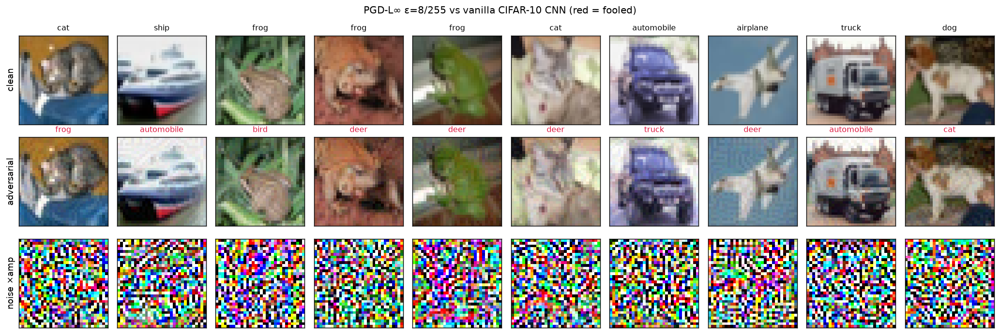
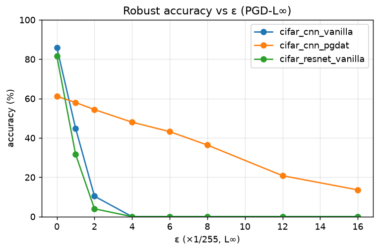
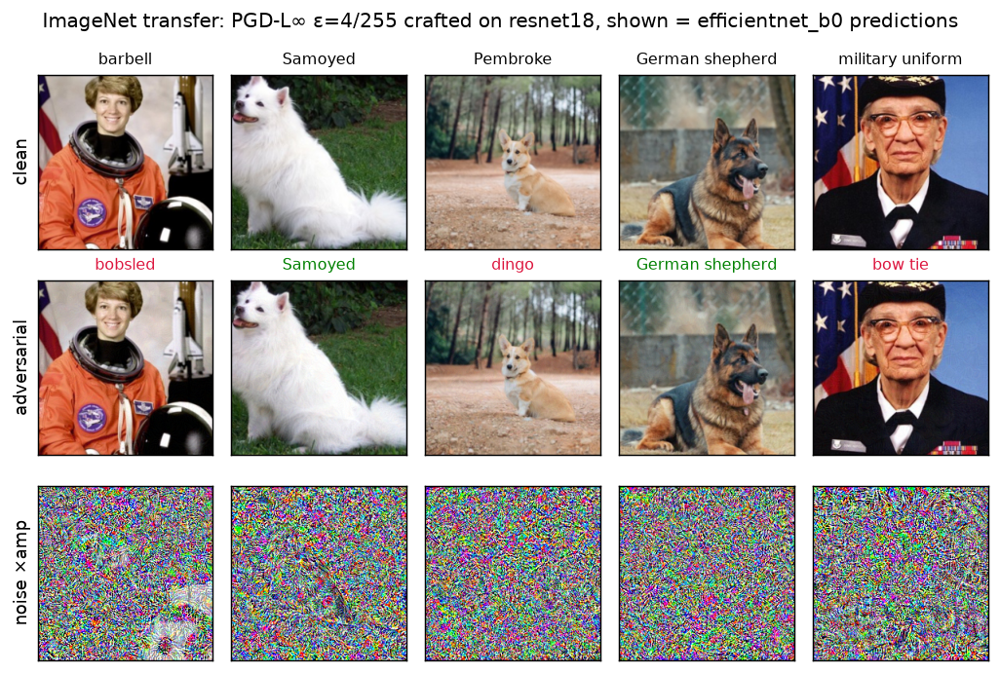

# AdvRobust Studio — Robustness Report

Generated 2026-11-09 22:54 CET · cpu · torch 2.15.0+cpu · n = 500 CIFAR-10 test images · seed 0

## Models

| Name | Arch | Training | Params | Train time |
|---|---|---|---|---|
| cifar_cnn_vanilla | cifar_cnn | vanilla (10 ep) | 288,746 | 432.1 s |
| cifar_cnn_pgdat | cifar_cnn | pgd (10 ep) | 288,746 | 2233.0 s |
| cifar_resnet_vanilla | cifar_resnet | vanilla (10 ep) | 78,042 | 288.9 s |

## White-box attacks (clean vs robust accuracy)

| Model | Attack | ε | Clean acc | Robust acc | ASR | mean L∞ | mean L2 |
|---|---|---|---|---|---|---|---|
| cifar_cnn_vanilla | fgsm | 8/255 | 86.8% | **2.2%** | 97.5% | 0.0314 | 1.723 |
| cifar_cnn_vanilla | pgd_linf | 8/255 | 86.8% | **0.0%** | 100.0% | 0.0314 | 1.385 |
| cifar_cnn_vanilla | pgd_l2 | 0.50 | 86.8% | **0.4%** | 99.5% | 0.0525 | 0.500 |
| cifar_cnn_vanilla | cw_l2 | 0.50 | 87.5% | **1.5%** | 98.3% | 0.0214 | 0.235 |
| cifar_cnn_pgdat | fgsm | 8/255 | 60.4% | **39.2%** | 35.1% | 0.0314 | 1.725 |
| cifar_cnn_pgdat | pgd_linf | 8/255 | 60.4% | **37.4%** | 38.1% | 0.0314 | 1.650 |
| cifar_cnn_pgdat | pgd_l2 | 0.50 | 60.4% | **48.2%** | 20.2% | 0.0834 | 0.500 |
| cifar_cnn_pgdat | cw_l2 | 0.50 | 63.5% | **49.0%** | 22.8% | 0.0365 | 0.193 |
| cifar_resnet_vanilla | fgsm | 8/255 | 81.0% | **2.2%** | 97.3% | 0.0314 | 1.723 |
| cifar_resnet_vanilla | pgd_linf | 8/255 | 81.0% | **0.0%** | 100.0% | 0.0314 | 1.378 |
| cifar_resnet_vanilla | pgd_l2 | 0.50 | 81.0% | **0.0%** | 100.0% | 0.0479 | 0.500 |
| cifar_resnet_vanilla | cw_l2 | 0.50 | 83.0% | **1.0%** | 98.8% | 0.0173 | 0.202 |

ASR = fraction of originally-correct images the attack flips. Max L∞ / L2 across all images never exceeds ε (checked in tests and below).

Budget audit

- cifar_cnn_vanilla / fgsm: max L∞ = 0.03137, max L2 = 1.7388
- cifar_cnn_vanilla / pgd_linf: max L∞ = 0.03137, max L2 = 1.4975
- cifar_cnn_vanilla / pgd_l2: max L∞ = 0.10652, max L2 = 0.5000
- cifar_cnn_vanilla / cw_l2: max L∞ = 0.05618, max L2 = 0.5000
- cifar_cnn_pgdat / fgsm: max L∞ = 0.03137, max L2 = 1.7388
- cifar_cnn_pgdat / pgd_linf: max L∞ = 0.03137, max L2 = 1.7093
- cifar_cnn_pgdat / pgd_l2: max L∞ = 0.21322, max L2 = 0.5000
- cifar_cnn_pgdat / cw_l2: max L∞ = 0.16548, max L2 = 0.5000
- cifar_resnet_vanilla / fgsm: max L∞ = 0.03137, max L2 = 1.7388
- cifar_resnet_vanilla / pgd_linf: max L∞ = 0.03137, max L2 = 1.5016
- cifar_resnet_vanilla / pgd_l2: max L∞ = 0.07844, max L2 = 0.5000
- cifar_resnet_vanilla / cw_l2: max L∞ = 0.05015, max L2 = 0.5000

## Adversarial training vs vanilla

Under PGD-L∞ (10 steps) at ε = 8/255: vanilla robust acc **0.0%** → PGD-AT robust acc **37.4%** (gap **+37.4 pp**). Clean accuracy cost: 86.8% → 60.4%.

## Robust accuracy vs ε

| ε | cifar_cnn_vanilla | cifar_cnn_pgdat | cifar_resnet_vanilla |
|---|---|---|---|
| 0/255 | 86.0% | 61.2% | 81.6% |
| 1/255 | 44.8% | 58.0% | 31.6% |
| 2/255 | 10.4% | 54.4% | 4.0% |
| 4/255 | 0.0% | 48.0% | 0.0% |
| 6/255 | 0.0% | 43.2% | 0.0% |
| 8/255 | 0.0% | 36.4% | 0.0% |
| 12/255 | 0.0% | 20.8% | 0.0% |
| 16/255 | 0.0% | 13.6% | 0.0% |

## Defenses

*unaware* = attack crafted on the undefended model (gray-box); *adaptive* = attack differentiates through the defense (BPDA for JPEG/bit-depth, EOT for smoothing). Adaptive numbers are the honest ones.

| Model | Defense | Setting | Attack | Clean acc | Robust acc |
|---|---|---|---|---|---|
| cifar_cnn_vanilla | none | white-box | pgd_linf 8/255 | 87.5% | **0.0%** |
| cifar_cnn_vanilla | jpeg | unaware | pgd_linf 8/255 | 80.0% | **6.5%** |
| cifar_cnn_vanilla | jpeg | adaptive | pgd_linf 8/255 | 80.0% | **1.0%** |
| cifar_cnn_vanilla | bit_depth | unaware | pgd_linf 8/255 | 87.0% | **0.0%** |
| cifar_cnn_vanilla | bit_depth | adaptive | pgd_linf 8/255 | 87.0% | **0.0%** |
| cifar_cnn_vanilla | smoothing | unaware | pgd_linf 8/255 | 48.0% | **6.5%** |
| cifar_cnn_vanilla | smoothing | adaptive | pgd_linf 8/255 | 48.0% | **0.0%** |
| cifar_cnn_pgdat | none | white-box | pgd_linf 8/255 | 63.5% | **36.0%** |
| cifar_cnn_pgdat | jpeg | unaware | pgd_linf 8/255 | 63.0% | **39.5%** |
| cifar_cnn_pgdat | jpeg | adaptive | pgd_linf 8/255 | 63.0% | **39.5%** |
| cifar_cnn_pgdat | bit_depth | unaware | pgd_linf 8/255 | 64.0% | **37.0%** |
| cifar_cnn_pgdat | bit_depth | adaptive | pgd_linf 8/255 | 64.0% | **37.0%** |
| cifar_cnn_pgdat | smoothing | unaware | pgd_linf 8/255 | 62.0% | **37.5%** |
| cifar_cnn_pgdat | smoothing | adaptive | pgd_linf 8/255 | 62.0% | **36.0%** |

## Black-box transfer

| Surrogate → Victim | Attack | ε | Surrogate adv acc (white-box) | Victim clean | Victim adv | Transfer rate |
|---|---|---|---|---|---|---|
| cifar_cnn_vanilla → cifar_resnet_vanilla | pgd_linf | 8/255 | 0.0% | 81.0% | 9.6% | 88.1% |
| cifar_resnet_vanilla → cifar_cnn_vanilla | pgd_linf | 8/255 | 0.0% | 86.8% | 14.0% | 83.9% |
| cifar_cnn_vanilla → cifar_cnn_pgdat | pgd_linf | 8/255 | 0.0% | 60.4% | 59.8% | 1.3% |
| resnet18 → efficientnet_b0 | pgd_linf (10 steps) | 4/255 | 0.0% | 100.0% | 40.0% | 60.0% |

> C&W is a simplified fixed-c variant (no binary search), projected into the same L2 ball as PGD-L2.
> ImageNet transfer row uses local photos without ground truth: accuracies are agreement with each model's own clean top-1 prediction.
> Randomized smoothing here is prediction-only (Monte-Carlo vote), no certified radius.
